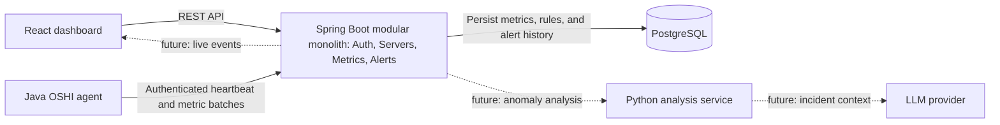

# NexusOps

**NexusOps is an in-progress server monitoring and incident intelligence platform.**
It provides a secure foundation for managing monitored hosts and collecting
system telemetry, with anomaly detection and AI-assisted incident analysis
planned as future capabilities.

## Overview

NexusOps combines a React dashboard, a Spring Boot modular-monolith backend, a
PostgreSQL data store, and a lightweight Java monitoring agent. The agent uses
OSHI to collect host metrics and sends authenticated heartbeats and metric
batches to the backend for persistence.

The project is being developed incrementally, with operational reliability and
clear module boundaries prioritized over premature service decomposition.

## Current capabilities

- User registration and login with BCrypt password hashing.
- Short-lived JWT access tokens and rotating, revocable refresh tokens.
- Role-based access for administrators, operators, viewers, and agents.
- Server registration, listing, updates, and decommissioning.
- Agent credential generation, rotation, and revocation; credentials are
  stored as hashes.
- Authenticated agent heartbeats and bounded metric batch ingestion.
- Per-server threshold rules for supported host metrics, with configurable
  comparisons, thresholds, severity, and enabled state.
- Sample-driven alert evaluation: a breach opens an alert immediately, and the
  first recovery sample resolves it.
- PostgreSQL persistence managed through Flyway migrations.
- OSHI collection of CPU, memory, disk, network, and process metrics.
- Docker Compose deployment for the frontend, backend, database, and optional
  monitoring agent.

The dashboard supports authentication, server listing, per-server recent
metric trends and samples, alert-rule management, and recent open or resolved
alerts. Incident grouping, assignment, notifications, and real-time updates
remain planned.

## Architecture



The backend groups authentication, server management, metrics, alert
evaluation, and shared security/web infrastructure in one application. Alert
evaluation runs as part of metric ingestion, while rules and alert history are
persisted in PostgreSQL. The monitoring agent is a separate executable
because it runs on monitored hosts. A Python analysis service is a future
extension, not part of the current deployment.

## Technology stack

| Area | Technologies |
|---|---|
| Backend | Java 25, Spring Boot, Spring Security, JDBC |
| Frontend | React, TypeScript, Vite |
| Database | PostgreSQL, Flyway |
| Monitoring agent | Java 25, OSHI |
| API | REST, JSON, JWT |
| Packaging and local deployment | Docker, Docker Compose, Nginx |
| Planned analytics | Python, scikit-learn |
| Planned incident intelligence | LLM API integration |
| Planned live updates | WebSockets |

## Roadmap

### In progress: monitoring and telemetry

- Complete agent configuration and resilient delivery.
- Expand metric aggregation, retention, and dashboard visualization.
- Improve agent and ingestion integration test coverage.

### In progress: alerting and incident response

- Add notification delivery through email or webhooks.
- Add incident grouping and timelines, plus assignment and acknowledgement.
- Expand alert lifecycle controls beyond sample-driven automatic recovery.

### Planned: real-time operations

- WebSocket updates for server health, metrics, alerts, and incidents.
- Live operational dashboards with reconnect handling.

### Planned: intelligence and analysis

- Python-based anomaly detection and model evaluation.
- Context-aware, structured LLM incident summaries and recommendations.
- Human-reviewed recommendations; no automatic remediation in the initial scope.

### Planned: production readiness

- Broader integration and load testing.
- Operational dashboards, backup/restore guidance, and deployment documentation.
- Continued security, dependency, and container-image reviews.

## Repository layout

```text
backend/    Spring Boot API, security, persistence, and database migrations
agent/      Standalone OSHI monitoring agent
frontend/   React and TypeScript application
```

## Project status

NexusOps is an active portfolio project. Authentication, server management,
metric ingestion, recent metric querying and visualization, per-server
threshold alerting, and the OSHI agent are implemented. Incident management,
WebSockets, anomaly detection, and LLM analysis remain future work.
